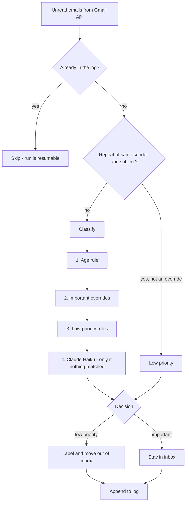

# gmail-triage-agent

A Python agent that triages an overloaded Gmail inbox. It reads unread mail, decides what is **important** and what is **low priority**, labels the low-priority mail and moves it out of the inbox. Cheap, explainable rules decide first. A Claude model (Haiku) is called only when no rule matches.

I built it for my own inbox, which had more than 10,000 unread emails, and it now runs every morning on a schedule.

## How it works



Rules are evaluated in a fixed order and the first match wins:
1. **Age:** mail older than 5 years is demoted, except from protected senders.
2. **Important overrides:** security alerts, job offers, interviews and similar always stay important, whatever else matches.
3. **Low-priority rules:** keywords, sender domains, sender + subject pairs.
4. **AI fallback:** the model gets the sender, subject and the first 500 characters of the body, and answers in one fixed line. Anything it returns that cannot be parsed stays **important**.

## Safety design

| Risk | Control |
|---|---|
| Hiding something that matters | Overrides run before every low-priority rule. Unparseable model output defaults to important. |
| Destructive actions | Only labels and moves out of the inbox. The public version requests the `gmail.modify` scope, which cannot permanently delete mail. |
| Accidental live run | The public version is a **dry run by default**. `--live` is needed to change anything. |
| Unsubscribe automation going too far | `unsubscribe.py` is read-only by default. `--apply` shows the full list and needs an explicit "yes". It never clicks links. |
| Interrupted run | The log is saved after every batch and already-processed ids are skipped, so it can simply be re-run. |
| Leaked credentials | `credentials.json`, `token.json`, `.env` and the personal rules file are git-ignored. |
| Scheduled run cannot log in | Headless runs refuse to open a browser or delete the token, and fail with a clear message instead. |

## Results (my own inbox, as of 2 November 2026)

- 11,528 emails classified: 1,615 important (14%) and 9,913 low priority (86%), with 0 errors.
- Runs every morning at about 09:00 through macOS `launchd`, and only processes new unread mail.

## What broke, and what I changed

Three failures, all found because a scheduled job fails quietly:
1. **Tokens expiring every 7 days (July 2026).** The Google OAuth app was in "Testing" mode, so Google revoked the refresh token weekly and the morning run stopped. I published the app to production and made the code handle a revoked token.
2. **A headless run deleting its own token.** When the token expired, the script deleted it and tried to open a browser, which does not exist under `launchd`, so every later run was stranded. It now refuses to delete the token or open a browser without a terminal and raises a clear error.
3. **A run that hung for 20 days.** The Gmail client library has no socket timeout by default, and `launchd` will not start a new run while the old one is alive, so one stalled connection blocked everything. I added a global 90-second socket timeout and a 2-hour watchdog that always ends the run.

A weekly health-check task also looks at whether the log was updated in the last ~36 hours.

## Changes in this public version

This repo is a cleaned-up copy of my private deployment, with these improvements:
- Rules moved out of the code into a config file (`config_example.py`; copy it to `config.py` for your own senders).
- Keywords match whole words only, so "deal" no longer matches "ideal", and a job offer is never mistaken for a promotion.
- Narrower Gmail scope (`gmail.modify`), dry run by default, and the Gmail service and label are looked up once per run instead of once per email.
- The two unsubscribe scripts were merged into one, and read errors are counted instead of silently ignored.
- 20 unit tests for the rule order, the model-output parsing, the resume and duplicate logic, and the unsubscribe helpers.

## Known limitations

- **Non-English mail.** Text is stripped to ASCII before it goes to the model (a workaround for an old encoding error), so Russian or other non-Latin emails are judged mostly on the sender and subject. The proper fix is to find the root cause of the encoding error and remove the stripping.
- **Rules need upkeep.** Keyword lists are hand-maintained. A small labelled sample of emails would let me measure how many are classified wrongly, and I have not built that yet.
- **No cost tracking** of model calls yet.

## Run it

```bash
pip install -r requirements.txt
cp config_example.py config.py        # then edit with your own senders
cp .env.example .env                  # add ANTHROPIC_API_KEY
# put Google OAuth credentials.json next to main.py (Gmail API, desktop app)
python main.py                        # dry run, nothing changes
python main.py --live                 # apply labels
python unsubscribe.py                 # list candidates (read-only)
python -m unittest discover -s tests  # run the tests
```

To schedule it on macOS, see `launchd/com.example.gmail-triage-agent.plist`.

## How this was built

Built with AI assistance (Claude). I design the rules and safety limits, review the code, run it every day and fix it when it breaks.
